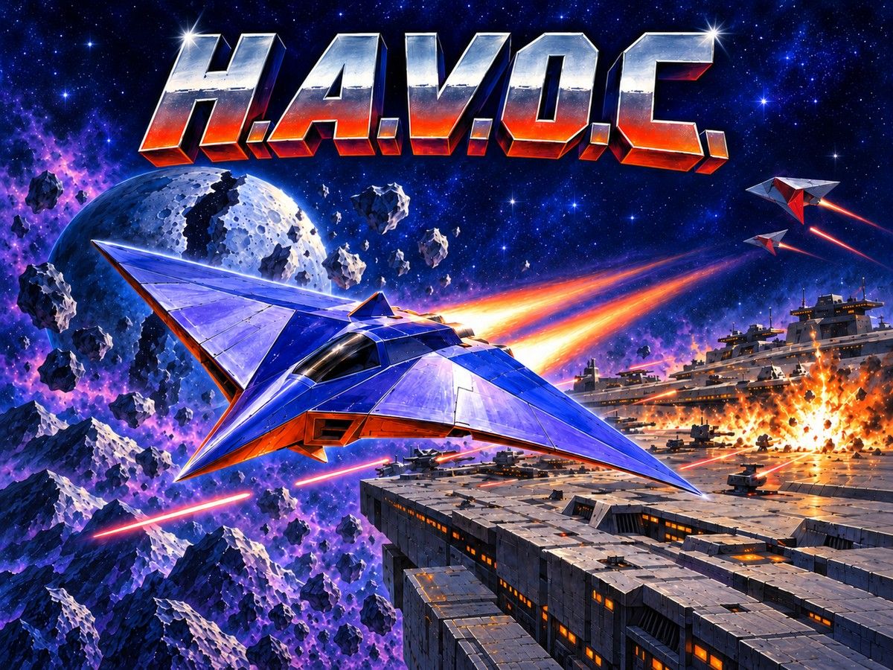

# H.A.V.O.C. Musicdisk

**The H.A.V.O.C. soundtrack, playing on the 64 MHz C64 Ultimate.**

<p align="center">
  <a href="docs/havoc-musicdisk.jpg">
    
  </a>
</p>

Twenty-one original recordings by William Echols, composed for
[H.A.V.O.C. (Heavy Assault Vessel: Orbital Combat)](https://github.com/fechols/havoc64u),
the 3D rail shooter for the C64 Ultimate. This musicdisk plays the complete
soundtrack in 16 kHz true stereo through Ultimate Audio while a full-screen,
16-color panorama for every song scrolls across the whole display, borders
included. The music is decoded from compressed DLT5 data in real time; songs
change without a loading gap, the outgoing one fading over its final second.
The playlist runs 34 minutes 38 seconds before it wraps.

## Download and run

1. Download `havocmd-musicdisk.zip` from the
   [latest release](https://github.com/fechols/havocmd/releases/latest).
2. Unzip it so the `havocmd` folder sits at the root of your SD card or USB
   drive. Keep all of its files together.
3. On the C64 Ultimate, select NTSC and HDMI output, apply `havocmd/havocmd.cfg`
   from the configuration menu, and run `havocmd/havocmd.prg`.

Do not preload or mount a REU image. The two `havocmd-N.reu` files are storage
volumes: the program finds its folder through the Ultimate Command Interface
and streams the ranges it needs into the machine's 16 MB REU as it plays.

The screen stays black for a moment while the first song and picture load and
the sampler is calibrated. Picture and music then start together. If the border
settles on a solid color, startup failed: **red** means a storage or Command
Interface problem, a missing volume or a bundle that does not match the PRG;
**purple** means Ultimate Audio is unavailable or disabled; **orange** means
invalid song or picture data or a sampler calibration failure. Fix the
configuration or restore the complete bundle, then reset and run again.

### Requirements

A C64 Ultimate or Ultimate 64 class machine. The player relies on the 64 MHz
turbo, a 16 MB REU, Ultimate Audio and the Command Interface, and the supplied
`havocmd.cfg` enables all of them: NTSC, turbo registers at 64 MHz, badline
timing off, quiet bus, REU preload off, Ultimate Audio mapped at `$DF20`, SID
sockets unmapped and the sampler mixed at +6 dB, panned wide.

## Controls

| Input | Action |
| --- | --- |
| **F1** / **F3** | Previous / next song. The current song keeps playing while its replacement is prepared. |
| **Space** | Next song, once per press. |
| **F5** | Resume automatic panning. |
| **F7** | Mute or unmute. Playback continues. |
| **Joystick, port 2** | Pan the picture by hand. **Fire** resumes automatic panning. |
| **Reset** | Exit. |

## Tracklist

Every recording plays to its original end, including its natural silences.

| # | Title | Length |
| ---: | --- | ---: |
| 1 | Hammond Rocker | 3:30 |
| 2 | Lowland Approach | 1:29 |
| 3 | Crystal Cave | 1:30 |
| 4 | Iron Canyon | 1:30 |
| 5 | Canyon Gate | 1:29 |
| 6 | Ashen Wastes | 1:31 |
| 7 | Foundry Belt | 1:30 |
| 8 | Fortress Run | 1:29 |
| 9 | Citadel Core | 1:30 |
| 10 | Storm Front | 1:29 |
| 11 | Meteor Reach | 1:30 |
| 12 | Carrier Coast | 1:29 |
| 13 | Carrier Assault | 1:30 |
| 14 | Asteroid Belt | 1:31 |
| 15 | Lunar Awe | 1:39 |
| 16 | Ship Graveyard | 1:31 |
| 17 | Orbital Shipyard | 1:30 |
| 18 | Space Carrier | 1:30 |
| 19 | Jump Gate | 1:29 |
| 20 | Mission Failed | 1:29 |
| 21 | Galactic Dash | 2:34 |

Each song is paired with its own picture; the Shattered Moon picture
accompanies Lunar Awe. After Galactic Dash the playlist returns to
Hammond Rocker.

## How it works

- **Player.** A `no_std` Rust program for the 6502, with the raster, pixel,
  sample-decode and copy kernels in assembly. Interrupts stay off; everything
  is scheduled against the raster at 64 MHz with badlines disabled.
- **Audio.** Each channel is stored as 3-bit delta codes (DLT5) and decoded
  live to signed 8-bit PCM for the Ultimate Audio sampler at 16,000 Hz. A ring
  buffer in the REU keeps about a quarter second of audio ahead of the DAC. The
  next song is prepared while the current one plays, then the two PCM streams
  are joined seamlessly with a one-second fade.
- **Pictures.** Every panorama is a 453 × 543 logical image in all 16 C64
  colors, rendered 200 × 240 at a time with double-width pixels through the
  border-color register, so the artwork covers the usual borders. The camera
  scrolls smoothly in two dimensions, reverses at the edges, and slides each
  new picture in with its song.
- **Storage.** Songs and pictures are packed into two 16 MiB `.reu` volumes
  with a replicated directory. The player streams 16 KiB chunks over the
  Command Interface into two 5 MiB REU slots, so no song ever needs the whole
  volume resident.
- **Verification.** Host models boot the linked PRG from dirty RAM and run it
  for at least 600 frames, comparing every stereo byte with an independent
  decoder and every rendered pixel with the original artwork while checking
  raster deadlines, loader progress and camera motion. Packaging checks every
  asset's provenance, checksums and volume layout before a bundle is finalized.

The [technical notes](docs/TECHNICAL.md) cover the runtime, content validation
and build pipeline in detail, and the bundle's own
[README.txt](target-c64/docs/musicdisk-readme.txt) is the player manual.

## Building from source

You need host Rust with the locked dependencies, FFmpeg and FFprobe on `PATH`,
Python 3, and a WSL distribution (`Ubuntu-24.04` by default) with
LLVM-MOS and the `mos` Rust toolchain for the `mos-c64-none` target. The
original recordings and splash artwork are stored with Git LFS:

```powershell
git lfs pull
powershell.exe -NoProfile -ExecutionPolicy Bypass -File scripts/build-musicdisk.ps1
```

The script encodes the music (resuming authenticated encodings), bakes the
artwork, verifies and packs the volumes, compiles the PRG, runs the offline
suite and finalizes `dist/havocmd` together with `dist/havocmd-musicdisk.zip`.
Add `-SkipEncoding` to reuse existing encodings. The PRG and the volumes must
come from the same build: the program checks their directory against its
compiled checksum. See the [technical notes](docs/TECHNICAL.md#build) for the
individual stages.

## Repository layout

- `target-c64/` — the C64 player (Rust and assembly), its C reference
  implementation, linker scripts and the bundle README.
- `src/` — the host tool that bakes artwork, packs volumes and checks bundles.
- `tools/` — the DLT5 encoder, the packaging pipeline and the host models and
  tests.
- `scripts/` — build entry points for PowerShell and WSL.
- `assets/` — recordings and splash art (LFS), the music catalog and the
  Ultimate configuration file.
- `docs/` — technical notes and the cover image.

## Status

Version 0.1.0 is a production candidate. The complete offline suite passes,
but the timing pass on a physical C64 Ultimate, covering startup, sustained
stereo playback, scrolling and song transitions, is still pending.

## License and credits

Project code is released under the [MIT License](LICENSE). The recordings and
artwork are by William Echols; the music license is
[`assets/music/LICENSE`](assets/music/LICENSE). The vendored encoder keeps its
`UNLICENSE` and `HAVOC-LICENSE` in `tools/encode-digital-music/`, and the
reused CPU interpreter keeps `tools/native_cpu.LICENSE`.
